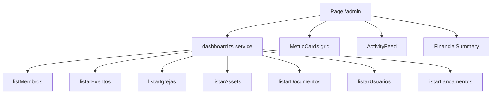

# Admin Dashboard Design

**Spec**: `.specs/features/admin-dashboard/spec.md`
**Status**: Draft

---

## Architecture Overview

Refatoracao da dashboard existente (`src/app/admin/page.tsx`) para adicionar metric cards, feed de atividade e financeiro expandido. Sem migration — todos os dados vêm de service functions existentes.



---

## Code Reuse Analysis

### Existing Components to Leverage

| Component | Location | How to Use |
| --------- | -------- | ---------- |
| `listMembros()` | `src/lib/admin/membros.ts` | Count `.length` for member metric |
| `listarEventos()` | `src/lib/admin/eventos.ts` | Count `.length` + recent items for feed |
| `listarIgrejas()` | `src/lib/admin/lideranca.ts` | Count `.length` for church metric |
| `listarAssets()` | `src/lib/admin/assets.ts` | Count `.length` + total value for asset metric |
| `listarDocumentos()` | `src/lib/admin/relatorios.ts` | Count `.length` for document metric |
| `listarUsuarios()` | `src/lib/admin/usuarios.ts` | `.total` for user metric |
| `listarLancamentos()` | `src/lib/admin/financeiro.ts` | Financial summary + recent transactions for feed |
| `getClaims()` | `src/lib/auth/claims.ts` | User info (email, role) |
| `can()` | `src/lib/auth/rbac.ts` | Dashboard access check |
| `formatarMoeda()` | already in dashboard page | Reuse for financial values |
| Card pattern | existing dashboard | Reuse for metric cards |

### Integration Points

| System | Integration Method |
| ------ | ------------------- |
| Existing services | Call list functions, compute `.length` and aggregates |
| RBAC | `can(papel, 'dashboard', 'ler')` for page access |
| Navigation | Cards link to existing admin pages |

---

## Components

### Service Layer: `src/lib/admin/dashboard.ts`

- **Purpose**: Aggregation functions for dashboard metrics and activity feed
- **Location**: `src/lib/admin/dashboard.ts`
- **Interfaces**:
  - `obterMetricas(): Promise<Metricas>` — returns counts for all 6 modules
  - `obterAtividadeRecente(): Promise<AtividadeItem[]>` — returns up to 10 recent items
  - `obterResumoFinanceiro(): Promise<ResumoFinanceiro>` — returns expanded financial summary
- **Dependencies**: All existing admin service functions
- **Reuses**: `listMembros()`, `listarEventos()`, `listarIgrejas()`, `listarAssets()`, `listarDocumentos()`, `listarUsuarios()`, `listarLancamentos()`

### Data Models

```typescript
interface Metricas {
  membros: number;
  eventos: number;
  igrejas: number;
  patrimonio: number;
  documentos: number;
  usuarios: number;
}

interface AtividadeItem {
  id: string;
  tipo: "membro" | "transacao" | "evento";
  titulo: string;
  subtitulo: string;
  criadoEm: string;
}

interface ResumoFinanceiro {
  receitas: number;
  despesas: number;
  saldo: number;
  topCategorias: Array<{ categoria: string; valor: number }>;
}
```

### Page: `src/app/admin/page.tsx` (modified)

- **Purpose**: Dashboard with metric cards, activity feed, financial summary
- **Changes**: Replace current single-column layout with grid sections
- **Sections**:
  1. Header (existing)
  2. Metric cards grid (new — 6 cards)
  3. Navigation cards (existing — keep as-is)
  4. Activity feed (new)
  5. Financial summary (existing — expand with top categories)
  6. User info + logout (existing)

---

## Layout Structure

```
max-w-6xl mx-auto px-4

[Header: Area Administrativa]

[Metric Cards Grid - 2 cols mobile, 3 cols tablet, 4 cols desktop]
┌──────────┬──────────┬──────────┬──────────┐
│ Membros  │ Eventos  │ Igrejas  │ Patrim.  │
│   45     │   12     │    3     │   28     │
├──────────┼──────────┼──────────┼──────────┤
│ Document.│ Usuarios │          │          │
│    8     │    5     │          │          │
└──────────┴──────────┴──────────┴──────────┘

[Navigation Cards - existing, kept as-is]
...7 cards...

[Two columns: Activity Feed + Financial Summary]
┌─────────────────────┬─────────────────────┐
│ Atividade Recente   │ Resumo Financeiro   │
│ • Joao - Ativo 2min │ Receitas  R$ 5.000  │
│ • R$ 200 Receita 5m │ Despesas  R$ 2.000  │
│ • Culto 25/09 1h    │ Saldo     R$ 3.000  │
│ ...                 │ ─────────────────── │
│                     │ Dizimos   R$ 3.000  │
│                     │ Ofertas   R$ 1.500  │
│                     │ Aluguel   R$ 800    │
└─────────────────────┴─────────────────────┘

[User Info + Logout]
```

---

## Error Handling Strategy

| Error Scenario | Handling | User Impact |
| -------------- | -------- | ----------- |
| Service function throws | Catch per-module, show "—" in metric card | Card shows dash instead of crashing |
| All services fail | Dashboard shows 0 counts + empty feed | Graceful degradation |
| Financial data unavailable | Show "R$ 0,00" | Same as empty state |

---

## Risks and Concerns

| Concern | Location | Impact | Mitigation |
| ------- | -------- | ------ | ---------- |
| Calling 7 list functions on every dashboard load | `dashboard.ts` | Performance: 7 DB queries per page load | Acceptable for MVP volume (AD-001: ~50 members, ~30 transactions/month); each query is simple SELECT |
| `.length` on full arrays | `dashboard.ts` | Memory: loads all rows into memory | Volume is small; Supabase returns arrays efficiently |
| Activity feed mixes different date formats | `dashboard.ts` | UX: inconsistent timestamps | Normalize all to ISO strings, format uniformly in component |

---

## Tech Decisions

| Decision | Choice | Rationale |
| -------- | ------ | ---------- |
| No migration | Existing tables have all needed data | Avoids scope creep; RF-030 handles audit log |
| Service aggregation in `dashboard.ts` | Dedicated file | Keeps dashboard page clean; testable functions |
| `.length` for counts | Simple approach | Volume is small (AD-001); no N+1 because each list is 1 query |
| Feed from 3 sources (membros, transacoes, eventos) | Merge + sort | Most relevant activity; documents and assets change rarely |
| RSC for dashboard | Server Component | Pattern from all admin pages; no client interactivity needed |

---

## Tips

- dashboard.ts is the main new file — keep it focused on aggregation
- The existing dashboard page is ~218 lines; after adding sections it will grow but should stay manageable
- metric cards are simple divs with icons — no client component needed
- activity feed items use relative time — add a small `tempoRelativo()` helper
- financial summary reuses existing `listarLancamentos()` and `formatarMoeda()`
