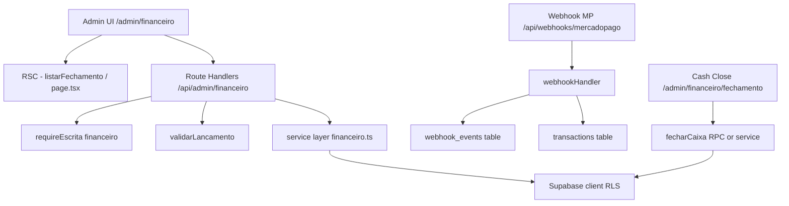

# Admin Financeiro Design

**Spec**: `.specs/features/admin-financeiro/spec.md`
**Status**: Approved

---

## Architecture Overview

Mesmo padrão CRUD dos módulos existentes (patrimonio, eventos): RSC lê, Route Handlers escrevem, service layer isolada, RBAC via `can_access('financeiro', ...)`.



---

## Code Reuse Analysis

### Existing Components to Leverage

| Component | Location | How to Use |
| --------- | -------- | ---------- |
| `authAdmin` / `requireEscrita` | `src/lib/admin/http.ts` | Guards de leitura/escrita para módulo `financeiro` |
| `erroCampos` | `src/lib/admin/http.ts` | Resposta 400 com campos discriminados |
| `createServerClient` | `src/lib/supabase/server.ts` | Cliente Supabase server-side com RLS |
| `can(papel, modulo, nivel)` | `src/lib/auth/rbac.ts` | Verificação de permissão |
| Padrão de validação | `src/lib/admin/validacao.ts` | Retorno `{ ok, dados }` ou `{ ok: false, campos }` |
| Padrão de migration | `supabase/migrations/0013_assets.sql` | Template: table + RLS + CHECK + seed idempotente |
| Dashboard cards | `src/app/admin/page.tsx` | Já existe card "Financeiro" — verificar se precisa de dados reais |

### Integration Points

| System | Integration Method |
| ------ | ------------------- |
| Supabase Postgres | `transactions`, `webhook_events`, `cash_closes` tables |
| Supabase RLS | `can_access('financeiro', ...)` policies |
| Mercado Pago (stub) | POST `/api/webhooks/mercadopago` — sem auth, validação de payload |

---

## Components

### Service Layer — `src/lib/admin/financeiro.ts`

- **Purpose**: Operações de domínio financeiro isoladas do Route Handler
- **Location**: `src/lib/admin/financeiro.ts`
- **Interfaces**:
  - `listarLancamentos(filtros?): Promise<Lancamento[]>` — lista com filtros opcionais (tipo, status, período, busca)
  - `buscarLancamento(id: string): Promise<Lancamento>` — busca por ID; lança `LancamentoNaoEncontradoError` se não existe
  - `criarLancamento(dados: LancamentoDados): Promise<Lancamento>` — INSERT com tipo/status/método validados
  - `atualizarLancamento(id: string, patch: LancamentoPatch): Promise<Lancamento>` — PATCH parcial; lança `LancamentoConciliadoError` se CONCILIADO
  - `cancelarLancamento(id: string): Promise<Lancamento>` — seta status CANCELADO; lança erro se não PENDENTE
  - `fecharCaixa(): Promise<FechamentoCaixa>` — agrega CONCILIADO, cria cash_close, retorna snapshot
  - `listarFechamentos(): Promise<FechamentoCaixa[]>` — lista fechamentos anteriores
- **Dependencies**: `@/lib/supabase/server`
- **Reuses**: padrão de `eventos.ts` / `assets.ts` (try/catch domain errors, `.single()`, `data ?? []`)

### Types — `src/lib/admin/financeiro-types.ts`

- **Purpose**: Tipos e constantes puras (sem server-side imports) — consumidos por client components
- **Location**: `src/lib/admin/financeiro-types.ts`
- **Conteúdo**:
  - `TIPOS_LANCAMENTO = ["RECEITA", "DESPESA"] as const`
  - `STATUS_LANCAMENTO = ["PENDENTE", "CONCILIADO", "CANCELADO"] as const`
  - `METODOS_PAGAMENTO = ["PIX", "CARTAO", "DINHEIRO", "TRANSFERENCIA"] as const`
  - Interfaces `Lancamento`, `LancamentoDados`, `LancamentoPatch`, `FechamentoCaixa`

> **Lessons aplicadas**: L-006 (greps de policy devem assertar role lists), L-008 (propriedades negativas precisam de assert explícito). Constantes em módulo puro (não em service server-only) — evitar bug de build do patrimônio (asset-types.ts).

### Validation — `src/lib/admin/validacao.ts`

- **Purpose**: Validação por campo de lançamentos financeiros
- **Location**: `src/lib/admin/validacao.ts` (adição ao arquivo existente)
- **Interfaces**:
  - `validarLancamento(body: Record<string, unknown>, modo: "completo" | "parcial"): ValidarLancamentoResultado`
  - Retorna `{ ok: true; dados: LancamentoDados }` ou `{ ok: false; campos: Record<string, string> }`
  - Valida: `descricao` (string não vazia), `valor` (number ≥ 0), `tipo` (RECEITA|DESPESA), `metodo` (PIX|CARTAO|DINHEIRO|TRANSFERENCIA), `data` (date YYYY-MM-DD válida)

### API Routes

| Route | Method | Guard | Behavior |
| ----- | ------ | ----- | -------- |
| `/api/admin/financeiro` | GET | `authAdmin("financeiro")` | Lista lançamentos com filtros query params |
| `/api/admin/financeiro` | POST | `requireEscrita("financeiro")` | Cria lançamento; 201 + entry |
| `/api/admin/financeiro/[id]` | GET | `authAdmin("financeiro")` | Busca lançamento por ID; 404 se não existe |
| `/api/admin/financeiro/[id]` | PATCH | `requireEscrita("financeiro")` | Atualiza parcial; 400 se CONCILIADO |
| `/api/admin/financeiro/[id]/cancelar` | POST | `requireEscrita("financeiro")` | Cancela (PENDENTE→CANCELADO); 400 se não PENDENTE |
| `/api/webhooks/mercadopago` | POST | **none** (webhook público) | Recebe notificação, loga em webhook_events, cria/atualiza transação |
| `/api/admin/financeiro/fechamento` | POST | `requireEscrita("financeiro")` | Fecha caixa; 400 se sem CONCILIADO |
| `/api/admin/financeiro/fechamento` | GET | `authAdmin("financeiro")` | Lista fechamentos |

### Pages

| Page | Type | Purpose |
| ---- | ---- | ------- |
| `/admin/financeiro/page.tsx` | RSC | Lista de lançamentos com filtros + link "Novo lançamento" |
| `/admin/financeiro/nova/page.tsx` | Client | Formulário de criação |
| `/admin/financeiro/[id]/page.tsx` | RSC | Detalhe do lançamento + botões editar/cancelar |
| `/admin/financeiro/fechamento/page.tsx` | RSC | Lista de fechamentos + botão "Fechar caixa" |

---

## Data Models

### transactions

```sql
CREATE TABLE public.transactions (
  id uuid PRIMARY KEY DEFAULT gen_random_uuid(),
  descricao text NOT NULL,
  valor numeric(12,2) NOT NULL CHECK (valor >= 0),
  tipo text NOT NULL CHECK (tipo IN ('RECEITA', 'DESPESA')),
  metodo text NOT NULL CHECK (metodo IN ('PIX', 'CARTAO', 'DINHEIRO', 'TRANSFERENCIA')),
  status text NOT NULL DEFAULT 'PENDENTE' CHECK (status IN ('PENDENTE', 'CONCILIADO', 'CANCELADO')),
  categoria text,
  observacoes text,
  data date NOT NULL DEFAULT CURRENT_DATE,
  external_reference text,
  webhook_event_id uuid REFERENCES webhook_events(id),
  cash_close_id uuid REFERENCES cash_closes(id),
  created_by uuid REFERENCES auth.users(id),
  created_at timestamptz NOT NULL DEFAULT now(),
  updated_at timestamptz NOT NULL DEFAULT now()
);
```

**Índices**:
- `idx_transactions_status` ON `(status)` — filtra PENDENTE/CONCILIADO
- `idx_transactions_data` ON `(data DESC)` — ordenação padrão
- `idx_transactions_external_ref` ON `(external_reference) WHERE external_reference IS NOT NULL` — lookup do webhook

### webhook_events

```sql
CREATE TABLE public.webhook_events (
  id uuid PRIMARY KEY DEFAULT gen_random_uuid(),
  event_id text NOT NULL UNIQUE,
  event_type text NOT NULL,
  payload jsonb NOT NULL,
  processed boolean NOT NULL DEFAULT false,
  created_at timestamptz NOT NULL DEFAULT now()
);
```

### cash_closes

```sql
CREATE TABLE public.cash_closes (
  id uuid PRIMARY KEY DEFAULT gen_random_uuid(),
  data_fechamento date NOT NULL DEFAULT CURRENT_DATE,
  total_receitas numeric(12,2) NOT NULL DEFAULT 0,
  total_despesas numeric(12,2) NOT NULL DEFAULT 0,
  saldo numeric(12,2) GENERATED ALWAYS AS (total_receitas - total_despesas) STORED,
  qtd_transacoes integer NOT NULL DEFAULT 0,
  observacoes text,
  created_by uuid REFERENCES auth.users(id),
  created_at timestamptz NOT NULL DEFAULT now()
);
```

### RLS Policies

```sql
-- transactions
SELECT: can_access('financeiro', 'ler') — authenticated
INSERT: can_access('financeiro', 'escrever') — authenticated
UPDATE: can_access('financeiro', 'escrever') — authenticated
-- sem DELETE policy (soft-delete por CANCELADO)

-- cash_closes
SELECT: can_access('financeiro', 'ler') — authenticated
INSERT: can_access('financeiro', 'escrever') — authenticated
-- sem UPDATE/DELETE (imutável)

-- webhook_events
-- sem RLS (escrita por service-role no webhook, leitura para debug)
-- OU: SELECT para ADMIN/SUPER_ADMIN apenas
```

---

## Error Handling Strategy

| Error Scenario | Handling | User Impact |
| -------------- | -------- | ----------- |
| JSON inválido no POST | `erroCampos({ form: "Corpo JSON inválido." })` → 400 | Mensagem genérica |
| Campo obrigatório ausente/inválido | `validarLancamento` retorna `{ ok: false, campos }` → 400 | Erro por campo |
| Transação CONCILIADO tenta editar | `LancamentoConciliadoError` → 400 `{ error: "transacao_conciliada" }` | Mensagem clara |
| Transação não é PENDENTE para cancelar | → 400 `{ error: "transacao_nao_cancelavel" }` | Mensagem clara |
| ID não existe | `LancamentoNaoEncontradoError` → 404 | Standard |
| RBAC negado | `requireEscrita`/`authAdmin` → 403 | Standard |
| DB error inesperado | catch → `console.error` + 500 `{ error: "erro_interno" }` | Genérico |
| Webhook payload inválido | → 400 `{ error: "payload_invalido" }` | Webhook caller |
| Webhook evento duplicado | UNIQUE on event_id → 200 sem duplicate | Idempotente |
| Fechar caixa sem CONCILIADO | → 400 `{ error: "sem_transacoes_para_fechar" }` | Mensagem clara |

---

## Risks & Concerns

| Concern | Location | Impact | Mitigation |
| ------- | -------- | ------ | ---------- |
| Webhook stub sem validação de assinatura — qualquer POST aceito | `src/app/api/webhooks/mercadopago/route.ts` | Segurança em produção (MP credentials pendentes) | Stub documentado; feature flag ou check de `MP_WEBHOOK_SECRET` — se não configurado, aceita tudo com log; quando configurado, valida x-signature |
| `cash_closes.saldo` é GENERATED COLUMN — Supabase pode não retornar no INSERT | `supabase/migrations/0014_financeiro.sql` | FE-10 (snapshot de totais) pode precisar de workaround | Testar INSERT + SELECT; se Supabase não retorna, calcular no service layer |
| Transações PENDENTE editáveis podem ter dados inconsistentes após webhook | `src/lib/admin/financeiro.ts` | Dados conflitantes se webhook e edição manual acontecem juntos | MVP: aceitar — volume baixo (~30/mês); conciliação manual resolve |
| Proxy route não ignora `/api/webhooks/*` — pode precisar de regra | `src/proxy.ts` | Webhook retornaria 401 em vez de passar | Verificar proxy; adicionar exemção se necessário |

---

## Tech Decisions

| Decision | Choice | Rationale |
| -------- | ------ | ----------- |
| Webhook como route handler sem auth | `verify_jwt: false` | Mercado Pago não envia JWT; validação por assinatura (futura) ou stub |
| Soft-delete por status CANCELADO (não hard-delete) | Mantém histórico; sem policy DELETE | Consistente com patrimonio/eventos |
| Fechamento de caixa como snapshot imutável | `cash_closes` sem UPDATE/DELETE | Histórico financeiro não pode ser alterado |
| `saldo` como GENERATED COLUMN | Cálculo automático no DB | Fonte única; evita desincronização |
| Types em módulo puro (`financeiro-types.ts`) | Evita bug de build (server-only em client component) | Lição do patrimônio (asset-types.ts) |
| Filtros como query params GET | Padrão REST; sem state no server | Consistente com listagens existentes |
