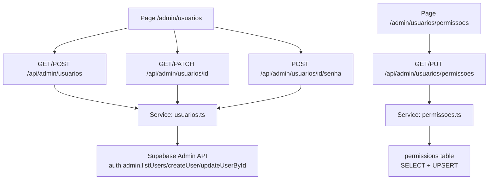

# Admin Usuários/Permissões Design

**Spec**: `.specs/features/admin-usuarios/spec.md`
**Status**: Draft

---

## Architecture Overview

Módulo CRUD completo para gestão de usuários admin e da matriz de permissões.
Sem migration — roles vivem em `app_metadata` (Supabase Auth), permissões na tabela `permissions` (migration 0008).



---

## Code Reuse Analysis

### Existing Components to Leverage

| Component | Location | How to Use |
| --------- | -------- | ---------- |
| `createAdminClient()` | `src/lib/supabase/admin.ts` | Service-role client for all Auth Admin API calls |
| `authAdmin(modulo)` | `src/lib/admin/http.ts:50` | Guard: read access to `usuarios` module |
| `requireAdministrar(modulo)` | `src/lib/admin/http.ts:87` | Guard: admin access for create/edit/reset/matrix |
| `erroCampos(campos)` | `src/lib/admin/http.ts:22` | Standard 400 error response |
| `getMatriz(papel)` | `src/lib/auth/rbac.ts:58` | Read-only matrix per role (used by page rendering) |
| `can(papel, modulo, nivel)` | `src/lib/auth/rbac.ts:90` | Fine-grained permission check |
| `ADMIN_ROLES` | `src/lib/auth/rbac.ts:4` | Constant: roles filterable in user listing |
| `MODULOS` | `src/lib/auth/rbac.ts:27` | Constant: modules for matrix columns |
| `gerarSenhaId()` | `src/lib/admin/membros.ts:112` | 16-char random password generator (letters+digits) |
| `denied-block` pattern | `src/app/admin/relatorios/page.tsx` | Access-denied block for users without permission |
| Dashboard card pattern | `src/app/admin/page.tsx` | Navigation card for "Usuários" |

### Integration Points

| System | Integration Method |
| ------ | ------------------- |
| Supabase Auth Admin API | `admin.auth.admin.listUsers()`, `createUser()`, `updateUserById()` via service-role |
| `permissions` table | Direct SQL SELECT/UPSERT (RLS: SELECT authenticated, write SUPER_ADMIN only) |
| RBAC guards | `authAdmin('usuarios')` for reads, `requireAdministrar('usuarios')` for writes |

---

## Components

### Service Layer: `src/lib/admin/usuarios.ts`

- **Purpose**: Business logic for user management (list, create, edit role, reset password)
- **Location**: `src/lib/admin/usuarios.ts`
- **Interfaces**:
  - `listarUsuarios(opts?: { role?: string }): Promise<ListarUsuariosResult>` — filters auth users by ADMIN_ROLES
  - `criarUsuario(dados: { email: string, role: string }): Promise<CriarResult>` — creates auth user with force_password_change
  - `editarPapel(userId: string, role: string, callerId: string): Promise<EditarPapelResult>` — updates app_metadata.role
  - `redefinirSenha(userId: string): Promise<RedefinirResult>` — generates new temp password + force_password_change
- **Dependencies**: `createAdminClient()` from `supabase/admin.ts`, `ADMIN_ROLES` from `auth/rbac.ts`, `gerarSenhaId()` from `admin/membros.ts`
- **Custom errors**: `EmailEmUsoError`, `NaoEncontradoError`, `AutoModificacaoError`, `SuperAdminProtegidoError`, `PapelInvalidoError`

### Service Layer: `src/lib/admin/permissoes.ts`

- **Purpose**: Business logic for permissions matrix (read + upsert)
- **Location**: `src/lib/admin/permissoes.ts`
- **Interfaces**:
  - `obterMatriz(): Promise<PermissaoRow[]>` — reads all rows from `permissions`
  - `atualizarMatriz(updates: Array<{ role, module, nivel }>): Promise<{ ok: true, updated: number }>` — upserts via service-role
- **Dependencies**: Supabase service-role client (bypasses RLS for writes)
- **Note**: SELECT can use regular authenticated client (RLS allows it); UPSERT needs service-role

### API Routes

| Route | Method | Guard | Service Call | Response |
| ----- | ------ | ----- | ------------ | -------- |
| `/api/admin/usuarios` | GET | `authAdmin('usuarios')` | `listarUsuarios({ role })` | 200 `{ users, total }` |
| `/api/admin/usuarios` | POST | `requireAdministrar('usuarios')` | `criarUsuario({ email, role })` | 201 `{ id, email, role, temporaryPassword }` |
| `/api/admin/usuarios/[id]` | PATCH | `requireAdministrar('usuarios')` | `editarPapel(id, role, claims.sub)` | 200 `{ id, email, role }` |
| `/api/admin/usuarios/[id]/senha` | POST | `requireAdministrar('usuarios')` | `redefinirSenha(id)` | 200 `{ id, email, temporaryPassword }` |
| `/api/admin/usuarios/permissoes` | GET | `requireAdministrar('usuarios')` | `obterMatriz()` | 200 `{ matrix }` |
| `/api/admin/usuarios/permissoes` | PUT | `requireAdministrar('usuarios')` | `atualizarMatriz(updates)` | 200 `{ ok: true, updated }` |

### Pages

| Page | Purpose | Key Elements |
| ---- | ------- | ------------ |
| `/admin/usuarios/page.tsx` | User list + create form | RSC, denied-block, table (Email/Papel/Status/Criação), role filter chips, create form, temporaryPassword display |
| `/admin/usuarios/permissoes/page.tsx` | Matrix editor | RSC, denied-block, table (roles × modules), inline nivel select per cell, save button |
| `/admin/page.tsx` (edit) | Dashboard card | "Usuários" card with `Users` icon after Relatórios |

### Client Components

| Component | Purpose | Location |
| --------- | ------- | -------- |
| `CreateUserForm` | Form for creating new admin user (email + role select) | `src/app/admin/usuarios/create-user-form.tsx` |
| `MatrixEditor` | Interactive table for editing permissions matrix | `src/app/admin/usuarios/permissoes/matrix-editor.tsx` |

---

## Data Models

No new DB tables. Existing models:

```typescript
// From auth/rbac.ts
type Modulo = 'dashboard' | 'membros' | 'igrejas' | 'eventos' | 'patrimonio' | 'financeiro' | 'relatorios' | 'usuarios' | 'configuracoes' | 'auditoria';
type Nivel = 'ler' | 'escrever' | 'administrar';
type AdminRole = 'SECRETARIA' | 'LIDER' | 'FINANCEIRO' | 'PATRIMONIAL' | 'ADMIN' | 'SUPER_ADMIN';

// From permissions table (migration 0008)
interface PermissaoRow {
  role: AdminRole;
  module: Modulo;
  nivel: Nivel;
  criado_em: string;
}

// Supabase Auth User (from admin.auth.admin.listUsers)
interface AuthUser {
  id: string;
  email: string;
  app_metadata: { role?: string; force_password_change?: boolean };
  created_at: string;
  last_sign_in_at?: string;
}
```

---

## Error Handling Strategy

| Error Scenario | Handling | User Impact |
| -------------- | -------- | ----------- |
| Email already exists | `EmailEmUsoError` → 409 | "Este email já está em uso" |
| User not found | `NaoEncontradoError` → 404 | "Usuário não encontrado" |
| Self role change | `AutoModificacaoError` → 403 | "Você não pode alterar seu próprio papel" |
| SUPER_ADMIN reassignment | `SuperAdminProtegidoError` → 403 | "Papel SUPER_ADMIN não pode ser reatribuído" |
| Invalid role | `PapelInvalidoError` → 400 | "Papel inválido" |
| Invalid nivel (matrix) | 400 from validation | "Nível inválido" |
| No session | Guard returns 401 | "Não autenticado" |
| Insufficient permissions | Guard returns 403 | "Não autorizado" |
| Supabase Auth API error | Catch → 500 `erro_interno` | "Erro interno" |

---

## Risks & Concerns

| Concern | Location | Impact | Mitigation |
| ------- | -------- | ------ | ---------- |
| `listUsers()` returns all auth users including MEMBROs | `usuarios.ts` | Performance: filtering client-side if many users | Filter by `ADMIN_ROLES` in service; for MVP volume (~10-20 users) this is acceptable |
| `app_metadata` update via Admin API requires service-role | `usuarios.ts` | Security: service-role key in env | Already used in `membros.ts`; same pattern |
| Matrix UPSERT may create new role rows not in ADMIN_ROLES | `permissoes.ts` | UI allows adding rows for roles that don't exist as auth users | Validate role against `ADMIN_ROLES` before upsert |
| No email uniqueness enforcement at DB level for auth users | Supabase Auth | Duplicate emails across auth.users | `EmailEmUsoError` catches Supabase's `user_already_exists` error |
| `force_password_change` is a custom claim, not native Supabase | `claims.ts` | Must be read/written in `app_metadata` | Already working for member flow (AD-013) |

---

## Tech Decisions

| Decision | Choice | Rationale |
| -------- | ------ | ---------- |
| No migration needed | — | Roles in `app_metadata`, permissions in existing `permissions` table (0008) |
| Filter users by ADMIN_ROLES in service | Client-side filter after `listUsers()` | Supabase Auth Admin API doesn't support role filtering; MVP volume is small |
| Matrix writes via service-role | Use `createAdminClient()` for UPSERT | RLS restricts writes to SUPER_ADMIN only; service-role bypasses RLS |
| Matrix reads via authenticated client | Use `getServerSession()` + regular client | RLS allows SELECT for all authenticated users |
| Reuse `gerarSenhaId()` from membros | Import from `@/lib/admin/membros` | Already tested, 16-char alphanumeric |
| Pages as RSC | Server Components with client islands | Pattern from all other admin pages (AD-016 compliant) |

> **Project-level decisions:** None new. Design conforms to AD-013 (Supabase Auth), AD-015 (permissions table), AD-016 (GET searchParams pattern).

---

## Tips

- Service layer handles all Supabase Auth Admin API calls — routes are thin
- `listUsers()` returns paginated results; for MVP, single page with `perPage: 100` is sufficient
- Matrix editor is SUPER_ADMIN-only; the guard `requireAdministrar('usuarios')` enforces this
- Temporary password is displayed once on creation/reset — no storage or recovery mechanism
- Denied-block pattern is consistent across all admin pages
