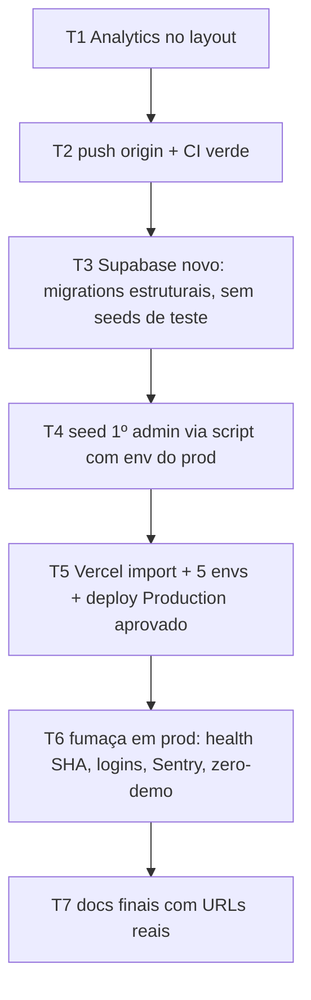

# Deploy em Produção (Fase 12) Design

**Spec**: `.specs/features/deploy-producao/spec.md`
**Status**: Draft

---

## Architecture Overview

Sequência ordenada para gastar o mínimo de deploys Hobby (10/dia): código
(Analytics) → push → Supabase novo → Vercel + envs → deploy → fumaça → docs finais.

---

## Code Reuse Analysis

### Existing Components to Leverage

| Component | Location | How to Use |
| --------- | -------- | ---------- |
| Root layout | `src/app/layout.tsx` | Recebe `<Analytics />` do `@vercel/analytics` |
| Seed admin por env | `scripts/seed-admin.mjs` (lê `NEXT_PUBLIC_SUPABASE_URL` + `SUPABASE_SERVICE_ROLE_KEY`) | Mira o prod via override de env, sem mudar código |
| Padrão de probe com BASE_URL | `scripts/probes-admin-financeiro.sh:30` (`BASE_URL` com default localhost) | `scripts/smoke-prod.sh` segue o mesmo contrato |
| Cookie jar p/ login | Lição das features admin (`curl -c/-b`, nunca token inline) | Reusada na fumaça de login em prod |
| Health exato | `src/app/api/health/route.ts` + tier da F11 | Fumaça asserta corpo com SHA real (≠ `unknown`) |

### Integration Points

| System | Integration Method |
| ------ | ------------------ |
| GitHub | Push `main` → CI (`tests`/`specs`/`cartao`) verde na HEAD |
| Supabase novo (operador cria) | Migrations via MCP/CLI, uma a uma, pulando seeds de teste; seed admin via script |
| Vercel Hobby (operador importa) | Preset Next.js, envs no dashboard, deploy Production aprovado |
| Sentry `[REDACTED_PROJECT_NAME]` | Mesmo projeto/DSN; `release` vira o SHA sozinho |

---

## Components

### Analytics no layout

- **Purpose**: Pageviews no dashboard Vercel (DEP-12/13).
- **Location**: `src/app/layout.tsx` (acréscimo) + `@vercel/analytics` em `dependencies`.
- **Interfaces**: `<Analytics />` default, sem eventos custom (sem PII por construção).
- **Dependencies**: T1 antes do push (evita deploy extra queimando a quota).
- **Reuses**: Nada — pacote oficial, 2 linhas.

### Push + CI

- **Purpose**: Base remota confiável (DEP-01..03).
- **Location**: `origin/main` (nenhum arquivo).
- **Interfaces**: `git push origin main`; `git rev-list --count` local == remoto; jobs verdes.
- **Dependencies**: Nenhuma (primeira operação; aval explícito já dado).
- **Reuses**: Hook `commit-msg` e CI existentes; nunca force-push.

### Supabase prod (migrations seletivas)

- **Purpose**: Schema completo sem dado de teste (DEP-04/05).
- **Location**: Projeto novo (operador cria e informa ref/keys); `supabase/migrations/`.
- **Interfaces**: Aplicar estruturais + `0016_settings` (config legítima); **pular** `0002`, `0004`, `0007`, `0009`, `0010`, `0018` (seeds/teste/demo — confirmar conteúdo de cada uma no Execute); `0003` (storage) aplica.
- **Dependencies**: Push feito (código-fonte das migrations versionado e no remoto).
- **Reuses**: Ordem numérica dos arquivos; MCP `apply_migration` ou CLI.

### Seed do 1º admin

- **Purpose**: Acesso inicial real (DEP-06).
- **Location**: `scripts/seed-admin.mjs` (sem mudança).
- **Interfaces**: `NEXT_PUBLIC_SUPABASE_URL=<prod> SUPABASE_SERVICE_ROLE_KEY=<prod-key> node scripts/seed-admin.mjs` (+ `SEED_ADMIN_EMAIL/PASSWORD` do operador, nunca commitados).
- **Dependencies**: Schema aplicado.

### Vercel + envs + deploy

- **Purpose**: Produção no ar (DEP-08/09).
- **Location**: Dashboard Vercel (operador importa o repo GitHub).
- **Interfaces**: 5 envs Production: `NEXT_PUBLIC_SUPABASE_URL`, `NEXT_PUBLIC_SUPABASE_PUBLISHABLE_KEY`, `SUPABASE_SERVICE_ROLE_KEY`, `SENTRY_DSN`, `NEXT_PUBLIC_SENTRY_DSN` (valores do Supabase/Sentry novos; copiar do dashboard, nunca no repo).
- **Dependencies**: Supabase pronto + CI verde; promoção só com aprovação explícita.
- **Reuses**: `release` automático (`VERCEL_GIT_COMMIT_SHA`).

### Fumaça em produção

- **Purpose**: Provar DEP-10/11 + DEP-05 em prod (novo `scripts/smoke-prod.sh <base-url>`).
- **Location**: `scripts/smoke-prod.sh`.
- **Interfaces**: health 200 corpo exato com SHA≠`unknown`; login membro + admin (cookie jar) 200/redirects; HTML contém tag Analytics; listagem admin mostra zero membros demo; Sentry com release do deploy (confirmação no dashboard).
- **Dependencies**: Deploy no ar.
- **Reuses**: Padrão BASE_URL + tiers da F11.

### Docs finais

- **Purpose**: DEP-14/15.
- **Location**: `docs/DEPLOYMENT.md` (reescrita da seção envs: fora Auth.js/Resend; dentro lista exata + 2 projetos + promoção/rollback).
- **Interfaces**: Terceiro executa promoção e rollback só pela doc.
- **Dependencies**: URLs reais conhecidas (pós-deploy).

---

## Data Models (if applicable)

Nenhum (sem migration nova; seleção das existentes).

---

## Error Handling Strategy

| Error Scenario | Handling | User Impact |
| -------------- | -------- | ----------- |
| Push rejeitado | Parar, nunca force-push (DEP-03) | Operador decide |
| Migration falha no projeto novo | Parar, diagnosticar, reaplicar do zero (projeto vazio, sem dado a perder) | Atraso, sem perda |
| Build falha na Vercel | Production segue no deploy anterior; fix em PR (novo deploy conta na quota) | Nenhum downtime |
| Env ausente/errada | Falha alta no deploy; corrigir no dashboard e redeployar | Janela sem deploy novo |
| Demo detectado em prod | Bloqueia entrega (DEP-05 gate); limpar antes de aprovar | Atraso, sem vazamento |
| Quota 10 deploys/dia | Aguardar janela; agrupar mudanças | Atraso operacional |

---

## Risks & Concerns

| Concern | Location (file:line) | Impact | Mitigation |
| ------- | -------------------- | ------ | ---------- |
| Segredos (service-role, DSN) em trânsito | envs e chat | Vazamento | Valores só via dashboard/env local; nunca em arquivo commitado, log ou probe; verificação por comportamento, não por valor |
| Seeds de teste entrarem no prod | `supabase/migrations/0002,0004,0007,0009,0010,0018` | Incidente de dados | Seleção explícita + gate DEP-05 (zero demo) antes de aprovar |
| Queimar quota Hobby com deploys repetidos | Vercel | Sem deploys no dia | Analytics no código ANTES do push; builds locais antes de cada push |
| `seed-admin` contra URL errada (dev) | `scripts/seed-admin.mjs:3-4` | Admin criado no ambiente errado | Env explícito no comando + conferência da URL (ref do projeto novo) antes de rodar |
| Supabase free limitações (pausa por inatividade) | projeto novo | Cold start / pausa | Documentar na F12; monitorar via health; avaliar na F13 |

> Lições aplicadas: L-014 (fumaça asserta corpos exatos); cookie-jar (nunca token inline); builds locais antes de push.

---

## Tech Decisions (only non-obvious ones)

| Decision | Choice | Rationale |
| -------- | ------ | --------- |
| Seeds no prod | Pular arquivos (não aplicar+tudo e limpar) | `0018` não tem DELETE por desenho; deletar `auth.users` é frágil; projeto nasce vazio |
| `0016_settings` | Aplica | Config legítima (18 chaves), não dado de teste |
| Analytics antes do push | T1 primeiro | Cada deploy conta na quota de 10/dia |
| Sentry | Mesmo projeto/DSN | `release` distingue os ambientes sozinho |
| Smoke script novo | `scripts/smoke-prod.sh` parametrizado | Reusável pós-F12 (pós-deploy, pós-rollback) |

> **Project-level decisions:** nenhuma nova prevista (usa AD-007/AD-009/AD-013/AD-033); se surgir, registra AD-034 no fechamento.
