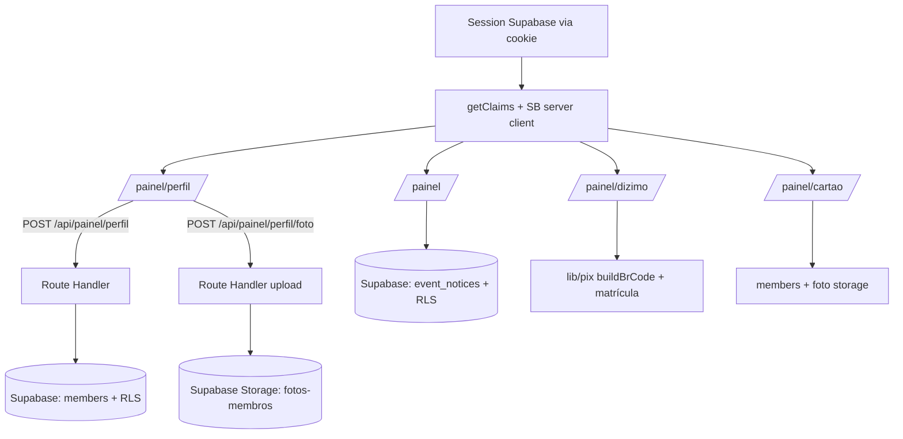

# Painel Membro Design

**Spec**: `.specs/features/painel-membro/spec.md`
**Status**: Draft

---

## Architecture Overview



Camadas (AD-002): RSC para leitura (server components) + Route Handlers para escrita (padrão já usado em `/api/auth/*`). Session é lida via `getClaims()` + `createServerClient` (`src/lib/supabase/server.ts`). Persistência via Supabase Postgres + Storage com RLS.

## Abordagens consideradas

| Abordagem | Prós | Contras | Veredito |
| --------- | ---- | ------- | -------- |
| **A. RSC para leitura + Route Handlers POST p/ escrita** | Padrão existente no repo (`/api/auth/*`); proxy já cobre `/painel/:path*`; sem lib de forms | Forms precisam de redirect/refresh pós-POST | ✅ recomendada |
| B. Server Actions (Next 16 native) | Forms gerenciam estado server-side | Novo padrão no repo; mistura com proxy/Route Handlers atuais; feature nova para os agents | não usada |
| C. Client Components + fetch | Interatividade rich | Mais JS client, duplica lógica, desvia do padrão RSC do projeto | não usada |

Decisão: **A** — consistência com o que já existe (RSC já lê `getClaims`; auth usa Route Handlers com forms `action="/api/..."`).

---

## Code Reuse Analysis

### Existing Components to Leverage

| Component | Location | How to Use |
| --------- | ---- | --- |
| `getClaims()` | `src/lib/auth/claims.ts` | Verifica sessão/papel em pages (`isMemberRole` de `rbac.ts`); precisa expor `sub` (user id) p/ ligar ao `members.auth_user_id` |
| `createServerClient` | `src/lib/supabase/server.ts` | Client Supabase server-side para inserts/selects/upload |
| `buildBrCode` | `src/lib/pix.ts` | Parâmetro extra `referenceLabel`/`txid` p/ QR pessoal; chave continua `PIX.key` |
| `PixDonation.tsx` | `src/components/PixDonation.tsx` | Reuso visual (QR + cópia) para `/painel/dizimo` |
| `isMemberRole` | `src/lib/auth/rbac.ts` | Gate de papel nas pages do painel |
| Proxy matcher | `src/proxy.ts` | Já cobre `/painel/:path*` (auth + papel + força-troca-senha) — 0 mudanças |
| `qrcode.react` | dependência (AD-012) | QR do dízimo |
| `src/lib/constants.ts` | CHURCH | Nome/CNPJ no cartão e QR |

### Integration Points

| System | Integration Method |
| ------ | ------------------ |
| Postgres (members, event_notices) | `supabase/migrations/*.sql` via CLI/MCP (decisão A da discussão) + query server-side com RLS |
| Supabase Storage (foto) | Upload via Route Handler com `createServerClient` da sessão; bucket `fotos-membros`; RLS storage |
| Supabase Auth | `getClaims()` (claims) + `auth.uid()` nas policies |

---

## Components

### Avisos — `/painel` (landing)

- **Purpose**: Listar avisos visíveis de eventos; estado vazio amigável; é a landing do painel.
- **Location**: `src/app/painel/page.tsx` (substitui a atual).
- **Interfaces**: Server Component que consulta `event_notices` ordenado por data desc, filtra `visivel = true`.
- **Dependencies**: session via `getClaims()`, Supabase server client.
- **Reuses**: layout de card/estado vazio do padrão do projeto; `lucide-react` (ícones).

### QR de dízimo — `/painel/dizimo`

- **Purpose**: Renderizar QR PIX pessoal (payload com matrícula no campo de referência) + código copiável.
- **Location**: `src/app/painel/dizimo/page.tsx` + cliente `src/components/...` (ou reuso direto de PixDonation com payload próprio).
- **Interfaces**: server prop `payload` = `buildBrCode({...})` com `txid`/referência = matrícula; redirect p/ perfil se sem `members`.
- **Dependencies**: registro em `members` (senão redirect PAINEL-07).
- **Reuses**: `PixDonation.tsx` (visual + cópia), `buildBrCode`, `CHURCH`.

### Cartão — `/painel/cartao`

- **Purpose**: Mostrar cartão (nome, matrícula, igreja, foto) + botão imprimir (CSS print).
- **Location**: `src/app/painel/cartao/page.tsx` + `src/app/painel/cartao/cartao.css` (ou `print:` classes tailwind).
- **Interfaces**: Server Component lê `members`; foto via Storage (URL pública do bucket/SQL `public_url`); `@media print` esconde o resto da página.
- **Dependencies**: registro `members`, foto opcional.
- **Reuses**: tailwind print variants; placeholder 4x4 padrão.

### Perfil — `/painel/perfil` (+ API)

- **Purpose**: Autocadastro/edição (nome, nascimento, WhatsApp) + upload foto 4x4.
- **Location**: `src/app/painel/perfil/page.tsx` (form GET pré-preenchido) + `src/app/api/painel/perfil/route.ts` (POST persistir) + `src/app/api/painel/perfil/foto/route.ts` (POST upload Storage).
- **Interfaces**:
  - `POST /api/painel/perfil`: body form (nome, nascimento, whatsapp) → valida → insert (autocadastro com matrícula gerada) ou update por `auth.uid()` → 201/200/4xx.
  - `POST /api/painel/perfil/foto`: multipart (file jpeg/png/webp ≤2MB, campo `foto`) → upload bucket `fotos-membros` path `members/{memberId}/foto-4x4.{ext}` → update `members.foto_url` → 200.
- **Dependencies**: session obrigatória (401 se não), validação no servidor (nunca confiar no cliente).
- **Reuses**: `createServerClient`, padrão de forms POST do auth.

### Lib de dados

- **Purpose**: Acesso a `members`/`event_notices` tipado.
- **Location**: `src/lib/painel/` (novo): `members.ts` (getByAuthUid, createWithMatricula, update) e `avisos.ts` (listVisiveis); `src/lib/pix.ts` ganha variante com label personalizado.
- **Interfaces**:
  - `getMemberByAuthUid(authUid: string): Member | null`
  - `createMember(...): { member, matricula }` (gerar `IVC-####`)
  - `updateMember(authUid: string, dados): void`
  - `listAvisosVisiveis(): Aviso[]`
  - `buildBrCodePessoal(matricula: string): string`
- **Reuses**: Supabase server client do `/painel` (session).

---

## Data Models

### members

```sql
create table members (
  id            uuid primary key default gen_random_uuid(),
  auth_user_id  uuid not null unique references auth.users(id) on delete cascade,
  nome          text not null check (char_length(trim(nome)) > 0),
  nascimento    date not null,
  whatsapp      text not null check (char_length(trim(whatsapp)) > 0),
  matricula     text not null unique,
  foto_url      text,
  criado_em     timestamptz not null default now(),
  atualizado_em timestamptz not null default now()
);
```

**RLS**: `auth.uid() = auth_user_id` para select/insert/update. `matricula` gerada no insert (formato `IVC-####` via `nextval` de sequence `members_matricula_seq` ou calculada por max+1 sob lock — decidir na implementação).

### event_notices

```sql
create table event_notices (
  id         uuid primary key default gen_random_uuid(),
  titulo     text not null check (char_length(trim(titulo)) > 0),
  data_hora  timestamptz not null,
  conteudo   text not null,
  visivel    boolean not null default true,
  criado_em  timestamptz not null default now()
);
```

**RLS**: `select` para papéis membro/admin usando `visivel = true`; escrita só via service-role/admin (definida como policy futura RF-024; por ora sem policy de escrita para usuário).

### Foto

- Bucket `fotos-membros`, path `members/{memberId}/foto-4x4.{ext}`.
- RLS storage: upload/select próprio (`auth.uid()` filtra por path/owner auth_user_id via metadados ou lookup).
- URL pública servida no cartão; `foto_url` = `public_url` do objeto.

---

## Error Handling Strategy

| Error Scenario | Handling | User Impact |
| -------------- | -------- | ----------- |
| Sem sessão ao acessar página | Proxy redireciona `/login` (já ativo) | Vai p/ login |
| Sem sessão no POST `/api/painel/*` | 401 | Form mostra erro genérico |
| Dados inválidos (nome vazio, nascimento inválido, whatsapp vazio) | Validação server → 400 com campos de erro | Erro inline no form |
| Foto tipo/tamanho inválido | 400 `?erro=foto_invalida` | Mensagem no form |
| Falha no upload (Storage) | 500 → form mantém dados, msg de erro | Reenvio sem perder campos |
| Falha ao ler avisos | Estado vazio sem quebrar (try/catch) | Página vazia amigável |
| Autocadastro duplicado | unique `auth_user_id` → 409 | Mensagem "cadastro já existe" |
| Membro sem registro acessa dizimo/cartao | redirect `/painel/perfil?primeiro=1` | Fluxo de autocadastro |

---

## Risks & Concerns

| Concern | Location | Impact | Mitigation |
| ------- | -------- | ------ | ---------- |
| `getClaims()` não expõe o `sub` (user id) | `src/lib/auth/claims.ts:5` | Não consigo ligar membro → `members.auth_user_id` | Estender `AuthClaims` com `sub` (mudança pequena no auth, sem quebrar callers) |
| Sem test runner até F10 (AD-006) | — | Probes precisam cobrir ACs | `scripts/probes-painel.sh` com rotas públicas/privadas + asserts de seed |
| `SUPABASE_SERVICE_ROLE_KEY` bloqueada | `.env.local` | Probes com sessão real inviáveis hoje | Seed SQL via MCP admin + probes de rotas/status sem sessão; sessão real fica p/ quando a chave for liberada (mesmo padrão do auth) |
| `qrcode.react` é client-only | `PixDonation.tsx:1` | QR precisa girar client ou payload server + lib client | Manter `PixDonation` renderizando payload server (como `/doacao` faz) — sem mudança |
| Proxy body buffer 10MB (upload) | `next.config` | Foto ≤2MB está folgado, mas uploads futuros maiores | Manter limite atual (2MB validação) |
| Operational: migrations novas não têm trilha no repo | sem `supabase/migrations/` | Perda de rastreabilidade se feito direto | Criar dir `supabase/migrations/` com SQL versionado + aplicar via CLI/MCP |

---

## Tech Decisions (only non-obvious ones)

| Decision | Choice | Rationale |
| -------- | ------ | --------- |
| Escrita perfil | Route Handler POST (`/api/painel/perfil` + `/foto`) | Padrão existente no auth; Server Actions é padrão novo |
| Migrations | SQL puro em `supabase/migrations/` | Decisão usuário (opção A); Drizzle adiado como evolução (AD-003 mantém) |
| Seed | SQL versionado (1 membro + 2 avisos) aplicado no dev | Decisão usuário; não depende de service-role |
| Matrícula | Sequência `IVC-####` gerada no insert | Sem admin p/ emitir; único + previsível |
| RLS por propriedade | Membros veem/alteram só a si; avisos leitura `visivel=true` | Segurança por padrão (SECURITY.md) |
| Foto | Bucket `fotos-membros`, RLS próprio membro + futuro admin | AD-003; documentos DATABASE.md |

---

## Tips

- **Reuso**: `PixDonation`, `createServerClient`, `getClaims`, proxy matcher — quase tudo existe.
- **Scope**: sem CRUD admin, sem extrato, sem edição de avisos (RF-024 vai criar policies).
- **Next null:** confirmar leitura de RSC + sub nos probes (sem sessão real de teste até service-role liberar).

> **Project-level decisions candidate:** "migrações Supabase em SQL puro versionadas" pode virar AD-014 (evolução futura c/ Drizzle). Será decidido na fase Tasks junto do user.