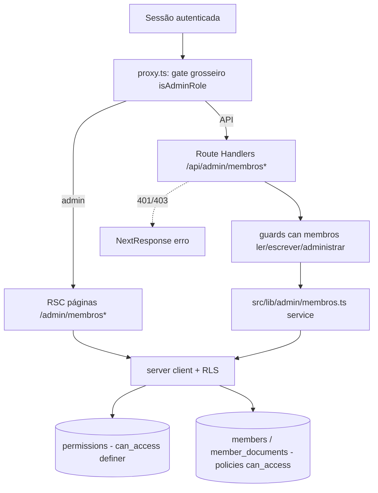

# Matriz de Permissões (RBAC) — Design

**Spec**: `.specs/features/rbac-matriz/spec.md`
**Status**: Draft

---

## Architecture Overview

A matriz vive no banco (`permissions`, PK role+module, nível ler/escrever/
administrar) como fonte única. Dois consumidores decidem a partir dela:

- **App layer**: `src/lib/auth/rbac.ts` ganha `can(papel, modulo, nivel)` que lê
  `permissions` pelo client de sessão (RLS libera SELECT a authenticated) com
  cache por request (`React.cache`). Os guards de `/api/admin/membros*` passam a
  ser module-aware: leitura `can(_,'membros','ler')`, escrita
  `can(_,'membros','escrever')`, hard-delete `can(_,'membros','administrar')`.
- **DB layer**: função `can_access(module, nivel)` (SECURITY DEFINER, papel do
  JWT via `auth_role()`, lê `permissions` sem RLS) decide nas policies RLS de
  `members`/`member_documents` — recriadas na migration 0008 para usá-la. É o
  backstop real: nada no supabase escapa.

Níveis hierárquicos (`ler < escrever < administrar`): quem tem `administrar`
concede ler/escrever/administrar; `escrever` concede ler/escrever; `ler` só ler.
Sem linha → nega (fail-closed).



---

## Code Reuse Analysis

### Existing Components to Leverage

| Component | Location | How to Use |
| --------- | -------- | ---------- |
| `auth_role()` (security definer) | `supabase/migrations/0006` | `can_access` reusa o papel do JWT |
| `createServerClient` + cookies | `src/lib/auth/claims.ts` | `getMatriz()` lê `permissions` com o mesmo pattern de $ |
| Guards `nengar`/`erroCampos` | `src/lib/admin/http.ts` | Shapes 401/403/400 preservados |
| Padrão security definer + revoke/grant | `0005`/`0006` | `can_access()` segue o padrão (definer, search_path public, revoke public) |
| Probes runtime | `scripts/probes-admin-membros.sh` | Regressão de paridade (106 ok) permanece válida |
| MCP Supabase (migrations) | dev `[REDACTED_PROJECT_REF]` | Aplica 0008 + checagens SQL na verificação |

### Integration Points

| System | Integration Method |
| ------ | ------------------ |
| Supabase RLS | policies de `members`/`member_documents` chamam `can_access('membros', ...)` |
| Route Handlers | `requireEscrita('membros')` / `requireAdministrar('membros')` |
| RSC pages admin | `nivelMembro()` (ler/escrever/administrar) para mostrar/ocultar ações |
| proxy.ts | Mantém `isAdminRole` — gate de roteamento, não autoridade por módulo |

---

## Components

### Migration `0008_permissions_matriz.sql`

- **Purpose**: cria a fonte única (tabela + RLS + seed 48 pares), a função
  `can_access()` e recria as policies de 0006 com a matriz.
- **Location**: `supabase/migrations/0008_permissions_matriz.sql`
- **Interfaces**:
  - `table public.permissions (role text, module text, nivel text, criado_em timestamptz)`,
    PK `(role, module)`, check `nivel in ('ler','escrever','administrar')`
  - RLS: SELECT `to authenticated` (lê); INSERT/UPDATE/DELETE `to authenticated`
    com `auth_role() = 'SUPER_ADMIN'`
  - `function public.can_access(p_module text, p_nivel text) returns boolean` —
    `language sql stable security definer set search_path = public`; lê
    `permissions` via `auth_role()`; hierarquia por CASE; `revoke public` +
    `grant execute to authenticated`
  - `drop policy if exists` + recreate `members_select_admin`/`members_insert_admin`/
    `members_update_admin`/`members_delete_admin`/`docs_select_admin`/
    `docs_insert_admin`/`docs_delete_admin` com `can_access('membros', ...)`
  - Seed 48 linhas com `on conflict (role,module) do nothing`
- **Dependencies**: `auth_role()` (0006). Nenhuma tabela nova de dados.

### `src/lib/auth/rbac.ts`

- **Purpose**: ontologia de papéis + avaliação module-aware da matriz.
- **Interfaces**:
  - `export type Nivel = "ler" | "escrever" | "administrar"`
  - `export const MODULOS = ["dashboard","membros","igrejas","eventos","patrimonio","financeiro","relatorios","usuarios","configuracoes","auditoria"] as const`; `export type Modulo = typeof MODULOS[number]`
  - `getMatriz(): Promise<Record<string, Nivel>>` — linhas do papel atual
    (`SELECT module, nivel FROM permissions` via client de sessão + `React.cache`)
  - `can(papel: string, modulo: Modulo, nivel: Nivel): Promise<boolean>` —
    hierarquia por `ORDEM: {ler:1, escrever:2, administrar:3}`; sem linha → false
  - `MANTER`: `ADMIN_ROLES`/`isAdminRole`/`isMemberRole` (ontologia p/ proxy)
  - `REMOVER`: `isAdminWriterRole`/`isHardDeleteRole`/`ADMIN_WRITER_ROLES` (superados
    pela matriz — atualiza callers)
- **Dependencies**: `createServerClient`, `cookies`, `React.cache`.
- **Reuses**: pattern de client de sessão de `claims.ts`.

### `src/lib/admin/http.ts`

- **Purpose**: guardas module-aware dos Route Handlers.
- **Interfaces** (assinaturas novas):
  - `authAdmin(modulo: Modulo)` → ler; **nova**: exige `can(_, modulo, 'ler')`
  - `requireEscrita(modulo: Modulo)` → exige `can(_, modulo, 'escrever')`
  - `requireAdministrar(modulo: Modulo)` → exige `can(_, modulo, 'administrar')`
  - removidas: `requireWriter`, `requireHardDelete`
  - `nengar()`/`erroCampos()` inalterados
- **Dependencies**: `getClaims`, `can`.
- **Reuses**: shapes de erro atuais.

### Route handlers `/api/admin/membros*`

- **Purpose**: piloto — passar `'membros'` aos guardas module-aware.
- **Mapeamento**:
  - `route.ts` (POST create) → `requireEscrita('membros')`
  - `[id]/route.ts` (DELETE) → `requireAdministrar('membros')`
  - `[id]/dados`, `[id]/status`, `[id]/documentos`, `[id]/documentos/[docId]` → `requireEscrita('membros')`
- **Reuses**: guardas novos de `http.ts`, serviço atual.

### Páginas RSC `/admin/membros*`

- **Purpose**: mostrar/ocultar ações conforme a matriz (escritor/hard-delete).
- **Interfaces**: helper `nivelMembro(): Promise<{ler,escrever,administrar}>`
  (wrap de `can` para o papel atual) → substitui `isAdminWriterRole`/
  `isHardDeleteRole` em `page.tsx`, `[id]/page.tsx`, `novo/page.tsx`.
- **Reuses**: `can`/`getMatriz`.

### Probes e verificação

- **Regressão**: `scripts/probes-admin-membros.sh` (106 ok) deve seguir verde —
  paridade da matriz com os role-lists atuais.
- **Novos checks (probe runtime)**: leitor (FINANCEIRO) escreve → 403; leitor
  lê listagem/detalhe → 200; `SECRETARIA` cria → 201; `ADMIN` hard-delete regras
  atuais. Reaproveita os checks existentes; adiciona os discriminativos.
- **Checagens SQL (verificação, via MCP)**: 48 linhas seed; `can_access` por
  papel retorna conforme a Anexo A; policies de 0006 referenciam `can_access`.

---

## Data Models

### Permissions

```typescript
type Nivel = "ler" | "escrever" | "administrar";
interface Permission {
  role: string;   // papel do app_metadata (MEMBRO/SECRETARIA/...)
  module: "dashboard" | "membros" | // ... MODULOS
  nivel: Nivel;
  criado_em: string; // timestamptz
}
```

**Relationships**: nenhuma FK — papéis não são tabela (vivem em
`app_metadata.role`, AD-013); módulos são enum em código.

**Hierarquia**: `ler=1 < escrever=2 < administrar=3`; `can(modulo, nivel)` vale
se `ORDEM[nivelRow] >= ORDEM[solicitado]`.

---

## Error Handling Strategy

| Error Scenario | Handling | User Impact |
| -------------- | -------- | ----------- |
| Sessão ausente | Guarda → 401 `nao_autenticado` | Redireciona/login |
| Papel sem linha ou nível insuficiente | Guarda/RLS → 403 `nao_autorizado` | Tela de acesso negado |
| Falha de leitura de `permissions` (DB fora/erro) | `can()` retorna false + log | Negado (fail-closed) — nunca concede por padrão |
| Erro na RPC/policy | Política false → SELECT vazio/força única | Dados não retornados/escrita bloqueada |
| Tabela vazia (seed ausente) | Sem linhas → tudo negado | Acesso admin negado até seed (fail-closed) |

---

## Risks & Concerns

| Concern | Location (file:line) | Impact | Mitigation |
| ------- | -------------------- | ------ | ---------- |
| Policies de 0006 recriadas em 0008 | `supabase/migrations/0006`:54-84 | Duplicação/erro se criar sem drop | `drop policy if exists` com os mesmos nomes antes do create |
| Role-lists somem do RLS — mutante acionável | policies 0006 | Regressão de role-list sem teste (lição L-006) | Probes discriminativos por papel (SECRETARIA 201, FINANCEIRO 403 na escrita/200 na leitura) + verificação SQL da Anexo A |
| `can()` adiciona query por guarda | `rbac.ts` | Overhead em rotas de API | Tabela ~48 linhas com PK; `React.cache` deduplica por request |
| Falha-closed mal aplicado | `can()`/`can_access` | Erro vira permissão | Retorno `false` em exceção + log; policy sem match já nega |
| Proxy segue `isAdminRole` (offline da matriz) | `src/proxy.ts:45` | Gate de rota mais frouxo que a matriz | Deliberado — proxy é roteamento; autoridade fina é RLS+guards (o proxy por si não expõe dados) |
| Seed divergir da Anexo A | `0008` | Acesso errado por papel | Verificação SQL: contagem 48 + spot-check por papel; tabela referencia |
| `React.cache` em route handlers | `rbac.ts` | Dados stale entre requests | `React.cache` é por request/render — sem cache entre requests |
| Renome de guards (`requireWriter` etc.) | 6 rotas + 3 páginas | Build quebra em caller esquecido | `npm run typecheck` deleta callers não migrados |

---

## Tech Decisions

| Decision | Choice | Rationale |
| -------- | ------ | --------- |
| Fonte da matriz | Tabela `permissions` no banco (não TS) | Decisão do usuário — editar sem deploy; RF-028 gerencia via UI |
| Decisão no banco | `can_access()` SECURITY DEFINER lendo papel do JWT | Papel vem do JWT server-side (AD-013); sem parâmetro de papel confiável em RLS |
| Decisão na app | `can()` lê `permissions` via session client (RLS) | Sem service-role para leitura de referência; RLS SELECT liberado a authenticated |
| Policy write em `permissions` | Só `SUPER_ADMIN` (auth_role) | Sem UI ainda (RF-028); seed via migração com `ON CONFLICT DO NOTHING` |
| Níveis | `ler` < `escrever` < `administrar`, hierarquia por ORDEM | AC MATRIZ-06; uma row por (papel,módulo) |
| Fail-closed | Sem linha ou erro → nega | AC MATRIZ-10/11; segurança por padrão |
| Proxy | Mantém `isAdminRole` (ontologia), sem ler o banco | Proxy roda fora do contexto de request RSC/DB; decisão fina fica ser server-side |
| Subsituição de helpers | Remove `isAdminWriterRole`/`isHardDeleteRole` e atualiza callers | Evita duas fontes de verdade no role-check |

> **Projeto-level (AD-015):** append ao `.specs/STATE.md` `## Decisions` — RBAC
> fino passa a ser definido pela tabela `permissions` (banco), consultada por
> `can()` na app e por `can_access()` no RLS; níveis hierárquicos; fail-closed;
> proxy permanece gate grosseiro; UI de gestão fica na RF-028.

---

## Tips
- `can_access` precisa de `revoke` de `public` + `grant execute to authenticated` (padrão 0005/0006)
- Seed e checks usam exatamente os nomes de módulo do Anexo A (snake_case: `relatorios`, `configuracoes`, `patrimonio`)
- Paridade: rodar `scripts/probes-admin-membros.sh` antes e depois do commit do piloto